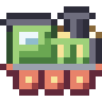
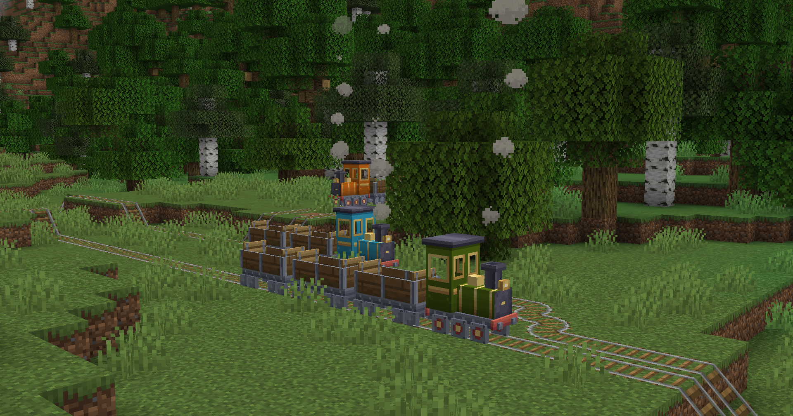
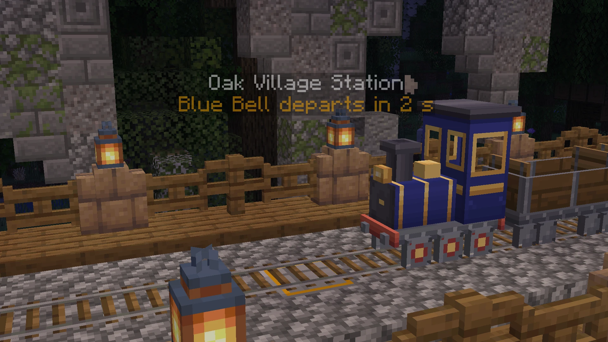
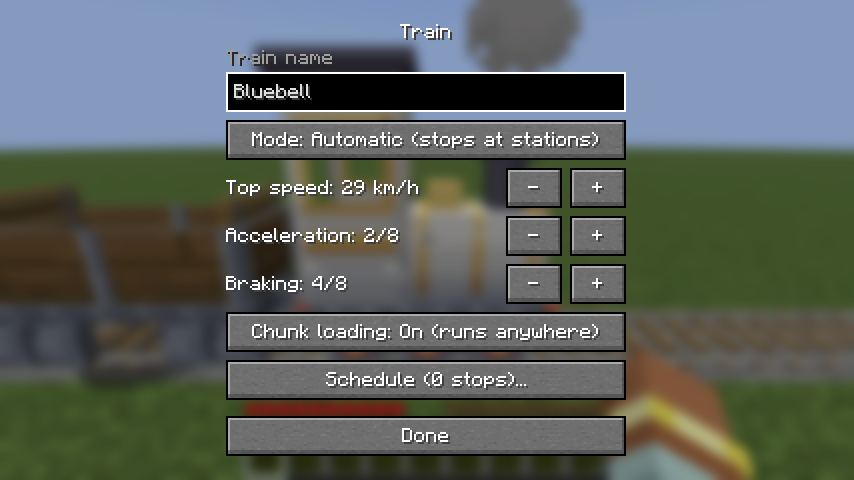

**Small, charming, coupled passenger trains for vanilla rails.**

Tiny Trains adds a little steam locomotive and open passenger coaches that run on the vanilla rails you already build. Couple
coaches on with a chain and drive the train yourself. Or switch it to automatic, and it runs a timetable between your stations,
finds its way through junctions and keeps running on the far side of the map.

It is **passenger only** by design: no freight, no inventories, no logistics. Just trains, people, and places to go.

> 📖 **The full guide is on the [Tiny Trains wiki](https://github.com/pvvlvz/TinyTrains-Issue-Tracker/wiki)**: every
> control, screen, track layout and message, plus troubleshooting.

## ✨ Features

| | |
|---|---|
| 🚂 **Coupled trains** | One locomotive pulls up to 8 coaches with exact spacing on straights, curves and slopes. |
| 🪑 **Real seats** | A driver's seat in the cab and two facing benches per coach. Up to 17 riders on a full train. |
| 🎮 **Manual driving** | Throttle notches on **W** / **S**, **Space** to stop. Speed and throttle show above the hotbar. |
| 🤖 **Automatic mode** | Trains stop at stations, wait, leave with a whistle, reverse at the end of the line and announce the next stop. |
| 🚉 **Stations** | Named station blocks with a floating sign and a live countdown to the next train. |
| 🗺️ **Timetables** | Up to 24 stops per train, looping forever. It runs straight through every other station. |
| 🔀 **Junctions** | Automatic trains pick their route and flip plain-rail switches themselves. |
| 🚦 **Signals** | An unpowered powered rail is a red signal. Trains press detector rails like minecarts. |
| 🛡️ **Collision safety** | Trains never hit each other: they follow at a safe distance and book single track, so they meet at passing loops. |
| 🌙 **Runs unattended** | Moving trains load their own chunks and carry on after a restart. Chunk loading can be switched off per train. |
| 🎨 **Paint jobs** | Craft a locomotive with any of the 16 dyes. |
| 🛠️ **Operator tools** | `/tinytrains list`, `tp` and `stop` to find and stop any train (permission level 2). |
| 💡 **Dynamic lights** | A built-in resource pack, off by default, lights up trains with LambDynamicLights. |
| 🗺️ **Web maps** | Stations and moving trains appear on squaremap (both editions) and Pl3xMap (Fabric only). |

## 📦 Editions and requirements

There are two editions. Download the file that matches your loader and Minecraft version.

| | **Fabric** | **NeoForge** |
|---|---|---|
| Minecraft | **26.3** | **1.21.1** |
| Loader | Fabric Loader **0.19.5** or newer | NeoForge **21.1** (tested with 21.1.266) |
| Required mods | [Fabric API](https://modrinth.com/mod/fabric-api) for 26.3 | None |
| Java | **25** | **21** |
| Release | 1.0.1 beta | 1.0.1 alpha |
| Optional web map (server only) | [squaremap](https://modrinth.com/mod/squaremap) 1.4.3+ or [Pl3xMap](https://modrinth.com/mod/pl3xmap) 26.3-557+ | [squaremap](https://modrinth.com/mod/squaremap) 1.3.2+ (Pl3xMap has no NeoForge build) |
| Optional dynamic lights (client only) | LambDynamicLights for 26.3 | LambDynamicLights for NeoForge 1.21.1 |
| Chains for coupling | Iron or copper | Iron (1.21.1 has no copper chain) |
| Empty dedicated server | Pauses after 60 s by default. Set `pause-when-empty-seconds=0` to keep trains running. | Keeps ticking, so trains run with nobody online. |

Both editions play the same apart from the rows above. The official launcher already ships the right Java version.

> ⚠️ **Install on both the client and the server.** The mod adds new entities and a new block, which a client
> without it can't show. On a server, give every player the same Tiny Trains file.

> ⚠️ **Back up your world before removing the mod.** Without it, trains and station blocks are deleted from the world.

## 🚀 Quick start

1. **Craft** a Locomotive, a Passenger Coach or two, a couple of Stations, and grab some chains. In creative they are in
   **Tools & Utilities** (or search "train").
2. **Lay track.** Any vanilla rails work. A long straight line is easiest to start with.
3. **Place the locomotive:** look along the track the way it should face and right-click a rail.
4. **Place a coach** on the rail right behind it (the end without the chimney).
5. **Couple:** hold a chain, right-click the coach, then the locomotive. You'll see *Coupled!* Always couple onto the
   last car.
6. **Board** with an empty hand, then hold **W** to drive. **S** closes the throttle, **Space** stops, **Sneak** gets off.
7. **Go automatic:** put a Station beside the rail near each end of the line. Then sneak and right-click the locomotive
   with an empty hand, set **Mode: Automatic** and press **Done**. It now shuttles between your stations by itself.

| Action | How |
|---|---|
| Train settings (name, mode, speed, schedule, chunk loading) | Sneak + right-click the locomotive with an empty hand |
| Station settings (name, waiting time) | Right-click the station block |
| Uncouple | Right-click a car with shears |
| Remove a car | Hit it like a minecart |

> 💡 The train keeps its throttle when you get off, so it carries on without you. To stop an automatic train,
> switch it back to **Manual** in its train screen.

## 🔨 Crafting

| Item | Recipe |
|---|---|
| **Locomotive** | Furnace in the middle, Minecart below it, Iron Ingots on both sides and in the top-right corner (shaped) |
| **Passenger Coach** | Glass Pane in the top middle, Minecart below it, Planks on both sides (shaped) |
| **Station** | Any Sign + Stone Bricks + Rail (shapeless) |
| **Painted Locomotive** | Locomotive + any dye (shapeless) |

The full recipe grids are on the [Items and Crafting](https://github.com/pvvlvz/TinyTrains-Issue-Tracker/wiki/Items-and-Crafting)
page, and every item has a tooltip that explains how to use it.

## 🧭 Good to know

- **Build passing loops** to run trains both ways on one line. Without one, opposing trains stop facing each other
  and wait.
- Only **plain rails** can be junctions. Route finding only sees loaded chunks, up to 4,096 rail blocks.
- Trains can't use portals. Build a separate line in each dimension.
- Vanilla minecarts and rails are unchanged, and there are no config files: everything is set in game.
- One kind of locomotive and one kind of coach. Coaches can't be painted.
- The NeoForge edition is an **alpha** port. Apart from the first picture, the pictures here and on the wiki were taken with the Fabric edition.

More in [Known Limitations](https://github.com/pvvlvz/TinyTrains-Issue-Tracker/wiki/Known-Limitations) and the
[FAQ](https://github.com/pvvlvz/TinyTrains-Issue-Tracker/wiki/FAQ).

## 🐛 Bugs and questions

Open an issue on the [issue tracker](https://github.com/pvvlvz/TinyTrains-Issue-Tracker/issues). Include your loader
(Fabric or NeoForge), your Minecraft, loader and Tiny Trains versions, and your other mods. If the game crashed, add
`logs/latest.log`.

---

Tiny Trains by **pvvlvz**. All models and textures are original, and the sounds reuse vanilla sound files.
**All Rights Reserved** © pvvlvz. Not an official Minecraft product. Not approved by or associated with Mojang or Microsoft.
