<div align="center">

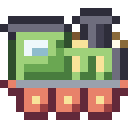

# Tiny Trains

**Small, charming, coupled passenger trains for vanilla rails.**<br>
Stations, timetables, junctions, passing loops, and trains that keep running when nobody is watching.


[](https://modrinth.com/mod/fabric-api)

[](https://github.com/pvvlvz/TinyTrains-Issue-Tracker/issues)

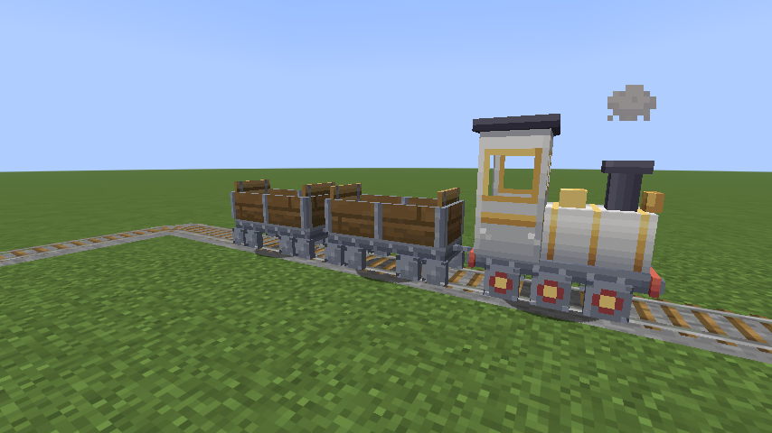

</div>

---

Tiny Trains adds a little steam locomotive and open passenger coaches that run on the rails you already have. Couple
coaches on with a chain, climb aboard and drive it yourself, or switch the train to **automatic** and let it run a
timetable between your stations: it finds its way through junctions, waits at passing loops for oncoming trains, and
keeps its own chunks loaded so a line keeps running on the far side of the map.

It is **passenger only** by design: no freight, no inventories, no logistics. Just trains, people, and places to go.

## ✨ Features

| | |
|---|---|
| 🚂 **Coupled trains** | One locomotive pulls up to 8 coaches with exact spacing on straights, curves and slopes. |
| 🪑 **Real seats** | A driver's seat plus two facing benches per coach. Everyone keeps their own seat. |
| 🎮 **Manual driving** | Throttle controls with speed shown above the hotbar. |
| 🤖 **Automatic mode** | Trains stop at stations, wait, leave, reverse at the end of the line and announce the next stop. |
| 🚉 **Stations** | Named station blocks with a floating sign and a live countdown to the next train. |
| 🗺️ **Timetables** | Up to 24 stops per train, looping forever. |
| 🔀 **Junctions** | Automatic trains pick their route and flip the switches themselves. |
| 🚦 **Signals** | An unpowered powered rail is a red signal. Trains press detector rails like minecarts. |
| 🛡️ **Collision safety** | Trains never hit each other. They follow at a safe distance and book single track so they meet at passing loops. |
| 🌙 **Runs unattended** | Moving trains load their own chunks and carry on after a restart. |
| 🎨 **Paint jobs** | Dye a locomotive any of the 16 colours. |
| 🗺️ **Web maps** | Stations and moving trains appear on squaremap and Pl3xMap. |
| 🛠️ **Operator tools** | `/tinytrains` lists, finds and stops any train. |

## 📦 Requirements

| What | Version |
|---|---|
| Minecraft: Java Edition | **26.3** |
| [Fabric Loader](https://fabricmc.net/use/) | **0.19.5** or newer |
| [Fabric API](https://modrinth.com/mod/fabric-api) | **0.164.0+26.3** or newer |
| Java | **25** (bundled with the official launcher) |
| *Optional:* [squaremap](https://modrinth.com/mod/squaremap) or [Pl3xMap](https://modrinth.com/mod/pl3xmap) | squaremap **1.4.3** / Pl3xMap **26.3-557** or newer, server only |

> ⚠️ **Install on both the client and the server.** The mod adds new entities and a block that an unmodded client
> can't show.

> ⚠️ **Back up your world before removing the mod.** Without it, trains and station blocks are deleted from the world.

## ⬇️ Installation

1. Install Fabric Loader for 26.3 with the [Fabric installer](https://fabricmc.net/use/).
2. Put **Fabric API** and **Tiny Trains** (from the Versions tab) in your `mods` folder.
3. Launch the Fabric profile. In creative, everything is in **Tools & Utilities** (or search "train").

**Dedicated servers:** put both jars in the server's `mods` folder and give every player the same jars. To keep
trains running while nobody is online, set `pause-when-empty-seconds=0` in `server.properties`.

---

## 🚀 Quick start: your first train in five minutes

1. **Craft** a Locomotive, a Passenger Coach or two, a couple of Stations, and grab some chains.
2. **Lay track.** Any vanilla rails. A long straight line is easiest to start with.
3. **Place the locomotive:** look along the track the way it should face and right-click a rail.
4. **Place a coach** on the rail right behind it (the end without the chimney).
5. **Couple it:** hold a chain, right-click the coach, then right-click the locomotive. You'll see **"Coupled!"**.
   Always couple new coaches onto the *last* car.

   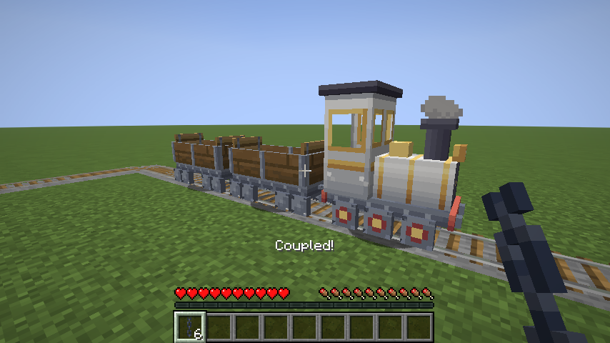

6. **Board:** right-click the locomotive with an empty hand.
7. **Drive:** hold <kbd>W</kbd> to open the throttle, <kbd>S</kbd> to close it, <kbd>Space</kbd> to stop.
8. **Go automatic:** put a Station beside the rail near each end of the line, get off, then **sneak + right-click** the
   locomotive with an empty hand. Set **Mode: Automatic** and press **Done**. It now shuttles between your stations
   by itself.

---

## 🔨 Crafting

<details>
<summary><b>Locomotive</b></summary>

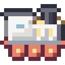

| | | |
|:---:|:---:|:---:|
| | | Iron Ingot |
| Iron Ingot | Furnace | Iron Ingot |
| Iron Ingot | Minecart | Iron Ingot |

A small iron-white tank engine. Seats one driver. 1.75 blocks long.

</details>

<details>
<summary><b>Passenger Coach</b></summary>

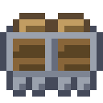

| | | |
|:---:|:---:|:---:|
| Any Planks | Glass Pane | Any Planks |
| Any Planks | Minecart | Any Planks |

An open wooden coach with two facing benches. Seats two. 2 blocks long.

</details>

<details>
<summary><b>Station</b></summary>

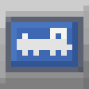

Shapeless: **any Sign + Stone Bricks + Rail**

Mine it with a pickaxe; it drops itself.

</details>

<details>
<summary><b>Tools (vanilla)</b></summary>

- **Chain** (iron or copper): couples cars. One is used up per coupling in survival.
- **Shears**: uncouple cars. Not used up.

</details>

<details>
<summary><b>🎨 Painting locomotives</b></summary>

Put a locomotive and **any dye** in a crafting grid (shapeless) to paint it, e.g. Locomotive + Red Dye = **Red
Locomotive**.

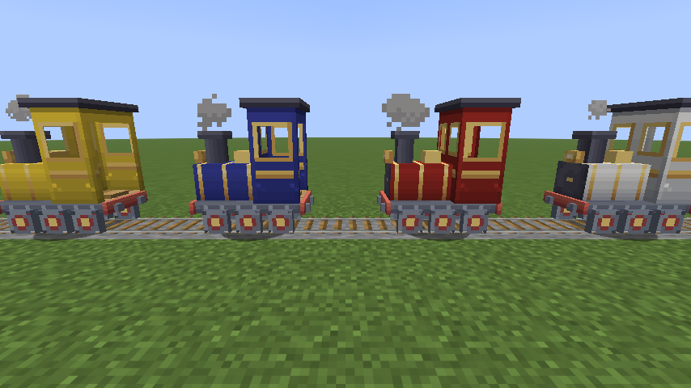

- All 16 dyes work; repainting replaces the old colour (dyes don't mix).
- Only the paintwork changes. Brass trim, chimney, chassis and wheels stay the same.
- The colour stays when placed, broken or pick-blocked.
- Uses vanilla's `minecraft:dyed_color` component, so commands work:
  `/give @s tinytrains:locomotive[minecraft:dyed_color=16711680]`

</details>

Every item has a tooltip explaining how to use it.

---

## 🎮 Controls

| Action | How |
|---|---|
| Place a car | Right-click any rail with a Locomotive or Coach. It faces the way you're looking. |
| Remove a car | Hit it like a minecart. Breaking a coach splits the train there and returns the chains. |
| Board / change seat | Right-click the car. You take the free seat nearest to where you clicked. |
| Get off | <kbd>Sneak</kbd>. You step off beside your own seat. |
| Couple | Chain: right-click the free coach, then the last car of the train (either order). |
| Uncouple | Shears on a coach (it and everything behind it) or on the locomotive (all coaches). |
| Train settings | <kbd>Sneak</kbd> + right-click the **locomotive** with an empty hand. |
| Station settings | Right-click the station block. |

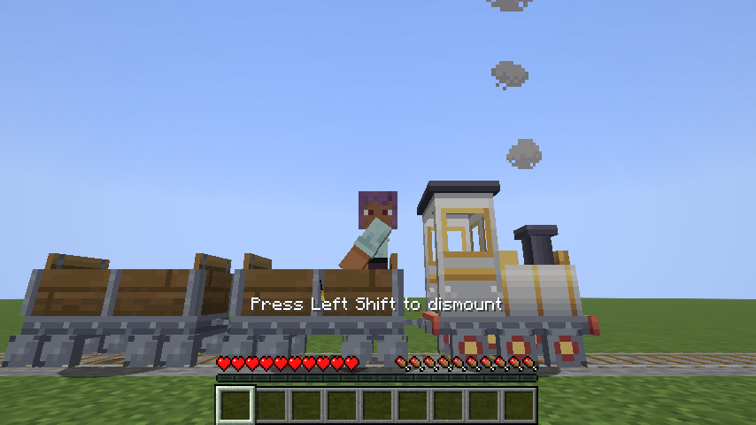 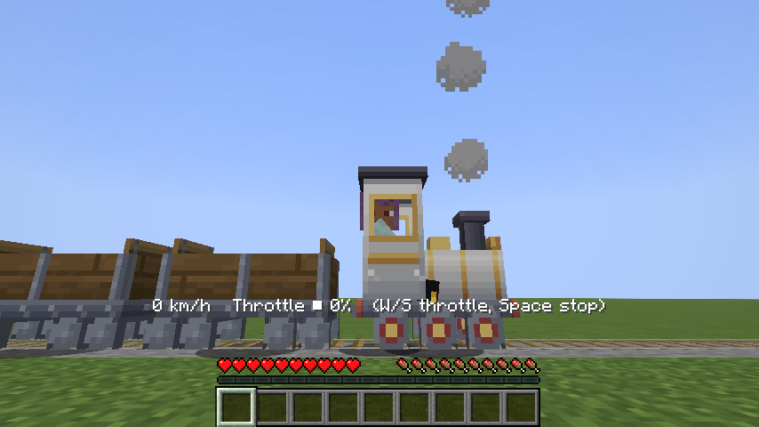

**While driving:**

| Key | Action |
|---|---|
| <kbd>W</kbd> | Open the throttle (about 5 s from stop to full) |
| <kbd>S</kbd> | Close the throttle; keep holding past zero to **reverse** |
| <kbd>Space</kbd> | Throttle to zero, brake to a stop |
| <kbd>Sneak</kbd> | Get off. **The train keeps its throttle**, so it carries on without you! |

The bar above your hotbar shows `17 km/h   Throttle ▶ 60%`. Even a manual train stops by itself for red signals,
other trains, and the end of the track.

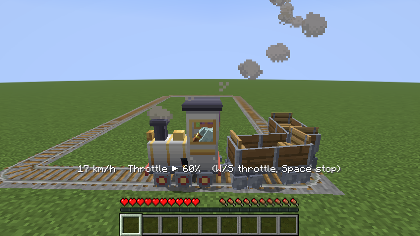

<details>
<summary><b>Coupling rules and messages</b></summary>

- A train has exactly one locomotive, at the front. Coaches can't form a train on their own.
- You can only add coaches to the **end** of a train, and only while it's **standing still**.
- The coach must be on the **same track, right behind** the train (within about 2.5 blocks of its spot).
- The two cars must be within 6 blocks of each other. Maximum **8 coaches**.

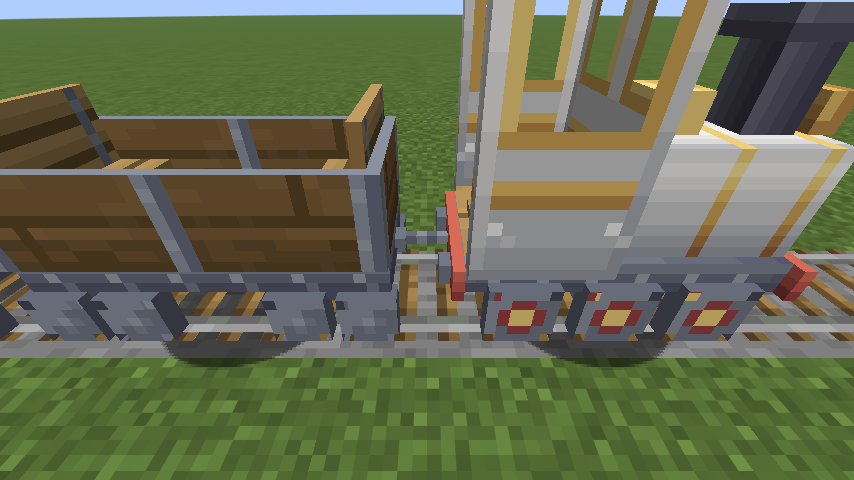

| Message | Fix |
|---|---|
| *Coaches can only couple onto a train with a locomotive.* | Couple onto a locomotive or a coach already behind one. |
| *Both cars are already coupled. Use shears to uncouple first.* | Shear one of them free first. |
| *Couple onto the last car of the train.* | You clicked a middle car. Click the last one. |
| *The coach must stand on the same track, right behind the train.* | Move the coach directly behind the last car on connected track. |
| *Stop the train before coupling.* | Stop it first. |
| *This train already has the most coaches a locomotive can pull.* | 8 is the maximum. |

</details>

---

## 🚉 Stations

Put a Station block **under** a rail, or **beside** it (same height or one lower). Automatic trains stop with their
front on that rail. A station touching two tracks gives **both** a platform with the same name.

| Setting | Range | Default |
|---|---|---|
| **Station name** | up to 32 characters | `Station` |
| **Trains wait** | 0 to 120 seconds | 5 s |

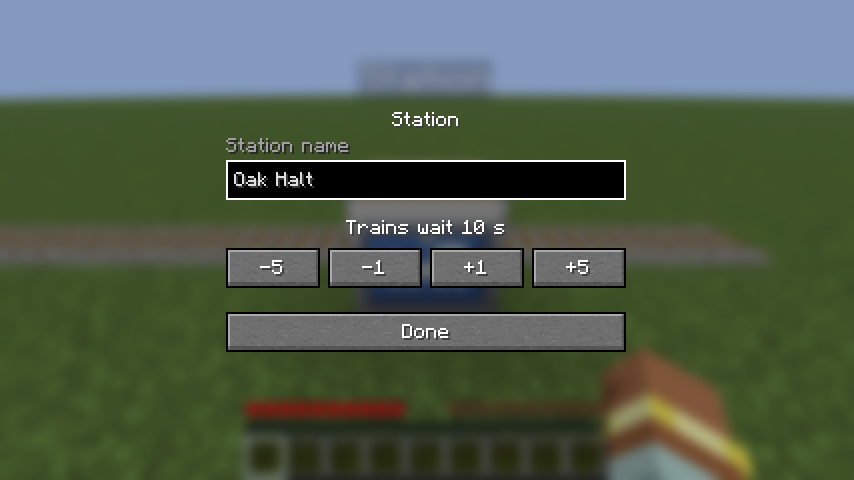

Each station shows its name floating above it, with a live line like *Next: Bluebell in 23 s* or *Bluebell departs in
5 s*. Stations with the **same name** act as one station with several platforms (names ignore upper/lower case).

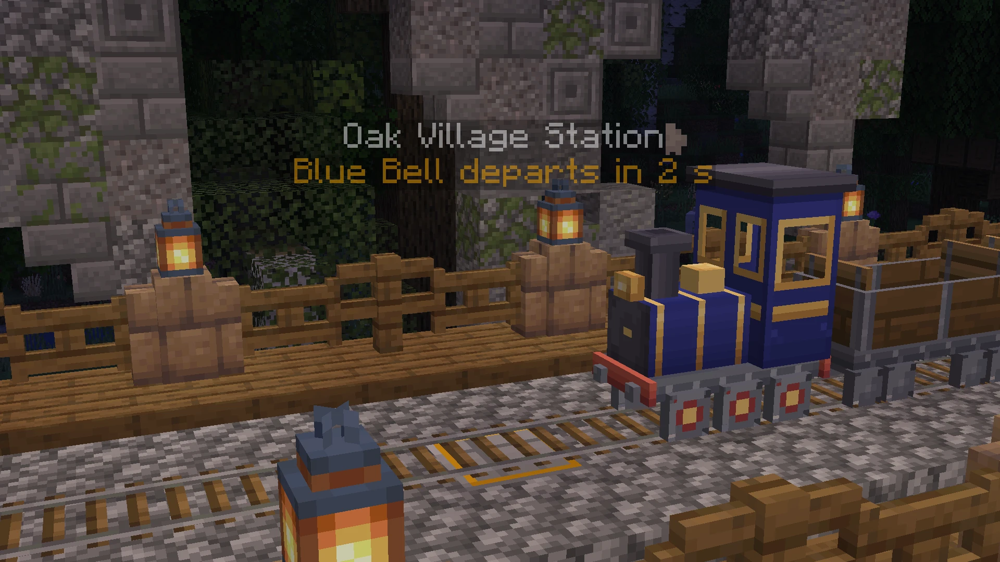

## ⚙️ The train screen

| Setting | Values | Default |
|---|---|---|
| **Train name** | up to 32 characters | none |
| **Mode** | Manual / Automatic | Manual |
| **Top speed** | 8 levels, 4 to 29 km/h | 29 km/h |
| **Acceleration** | 1 to 8 | 2 |
| **Braking** | 1 to 8 | 4 |
| **Chunk loading** | On / Off | On |
| **Schedule** | up to 24 stops | none (stop everywhere) |

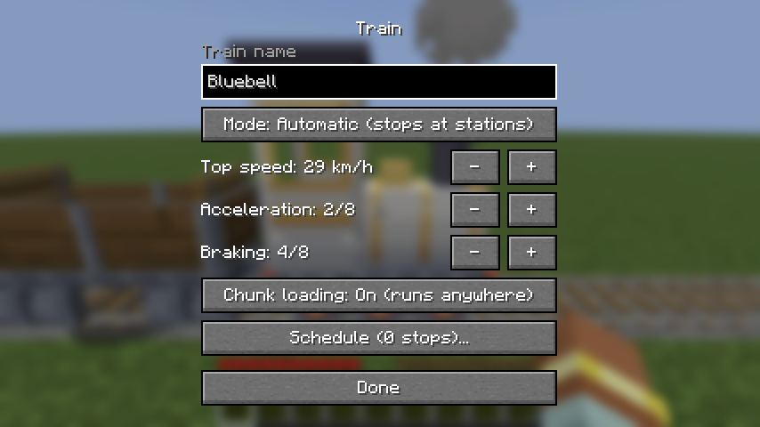

<details>
<summary><b>What the speed, acceleration and braking levels mean</b></summary>

| Level | Top speed | 0 → 29 km/h | 29 km/h → 0 |
|:---:|---|---|---|
| 1 | 4 km/h | 8 s | 4 s (16 blocks) |
| 2 | 7 km/h | **4 s** *(default)* | 2 s (8 blocks) |
| 3 | 11 km/h | 2.7 s | 1.3 s (5.3 blocks) |
| 4 | 14 km/h | 2 s | **1 s (4 blocks)** *(default)* |
| 5 | 18 km/h | 1.6 s | 0.8 s (3.2 blocks) |
| 6 | 22 km/h | 1.3 s | 0.7 s (2.7 blocks) |
| 7 | 25 km/h | 1.1 s | 0.6 s (2.3 blocks) |
| 8 | **29 km/h** *(default)* | 1 s | 0.5 s (2 blocks) |

</details>

---

## 🤖 Automatic trains and schedules

An automatic train needs nobody on board. It:

1. Runs at its top speed.
2. **Stops at stations**: every station if it has no schedule, or only its current stop if it does.
3. Waits the station's waiting time, then leaves with a whistle and announces **"Next stop: …"** to its riders.
4. **Reverses at the end of the line** after a 2 s pause.
5. Waits for other trains and red signals (*"Waiting for the line ahead to clear"*).

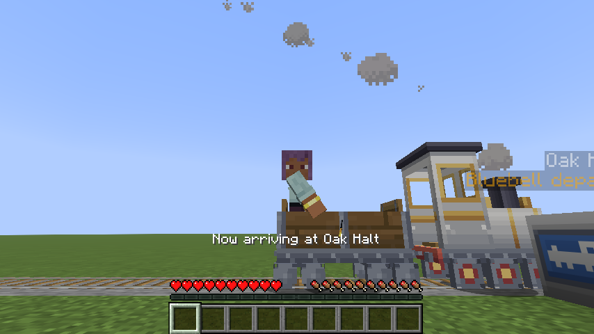

**Schedules:** in the train screen, click **Schedule…**, pick station names with **<** / **>**, and **Add** them (up
to 24). The train visits each in order, runs straight through every other station, and starts over from stop 1 after
the last.

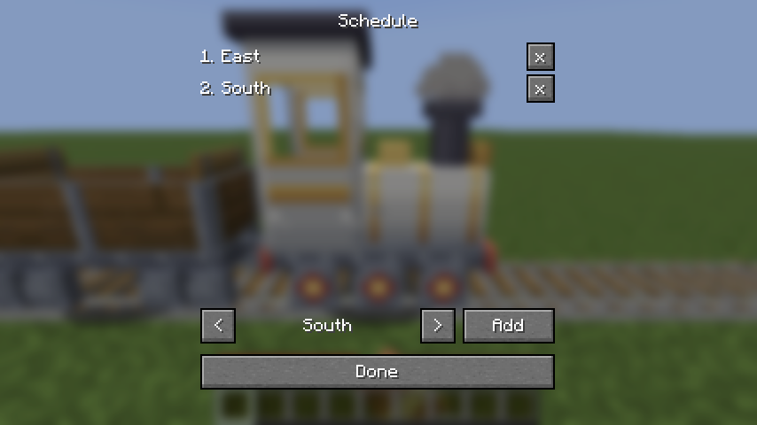

| Schedule | What the train does |
|---|---|
| *(empty)* | Stops everywhere, reverses at each end. |
| `Harbour`, `Castle` | Express between the two ends. |
| `Harbour`, `Market`, `Castle`, `Market` | Stopping service along the line. |
| `Market`, `Mine` | Shuttle onto a branch line. |

> 💡 **Terminus tip:** put the station within **4 blocks** of the end of the track so the train reverses right after
> its stop.

> 🛑 **To stop an automatic train,** switch it back to **Manual** in the train screen.

## 🔀 Junctions, signals and safety

- **Junctions** are **plain rails** joined from three or four sides (a normal vanilla T-junction). Automatic trains
  with a schedule flip them towards their next stop. Manual trains and trains without a schedule follow the switch as
  it's set.
- **Signals:** an **unpowered powered rail** is red and every train stops before it. Power it (lever, clock, daylight
  sensor…) to let trains through. Powered rails don't boost trains.
- **Detector rails** turn on while any part of a train is over them, just like with minecarts.
- **Safety:** trains stop half a block behind the train ahead. Automatic trains **book** single-track stretches up to
  the next junction, so opposing trains wait and then pass each other in a **passing loop**.

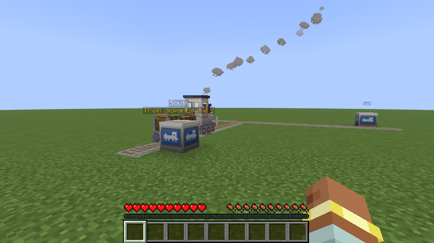

> ❗ **Running trains both ways on one line? Build passing loops.** Without one, opposing trains stop facing each
> other and wait forever.

<details>
<summary><b>🛤️ Track-building cookbook</b></summary>

Legend: `═ ║` rail, `╔ ╗ ╚ ╝` curves, `╦ ╩` junctions (plain rails), `[S]` station, `P` powered rail.

**1. Shuttle line**: one automatic train, empty schedule, stations within 4 blocks of each end.
```
 [S] West ═══════════════════════════════════════ [S] East
```

**2. Circle line**: any number of trains, empty schedules. They follow each other round.
```
 ╔═════════[S] Hill═════════╗
[S] Lake                  [S] Mill
 ╚═════════[S] Town═════════╝
```

**3. Single line with a passing loop**: Train 1 schedule `B`, `A`; Train 2 schedule `A`, `B`. They cross in the loop.
```
[S] A ═══════════╦═══════════════╦═══════════ B [S]
                 ╚═══════════════╝
```

**4. Main line with a branch**: express `Harbour`, `Castle`; mine shuttle `Market`, `Mine`.
```
                              ╔═════════ [S] Mine
[S] Harbour ════[S] Market════╩═════════ [S] Castle
```

**5. Island platform**: leave a one-block gap inside a loop and put the station in it. Both tracks get the platform.
```
 A ══════════╦═════════════════╦══════════ B
             ║   [S] Central   ║
             ╚═════════════════╝
```

**6. Depot with a signal**: park spare trains behind an unpowered powered rail; flip a lever to release them.
```
 main line ═══════╦═══════════
                  P  ← lever
             [S] Depot
```

</details>

---

## 🌙 Chunk loading

An **active** train (automatic, open throttle, or still rolling) keeps the chunks around it loaded, about 50 to 75
chunks, far fewer than a player. A **parked manual train** loads nothing. Running trains carry on after a restart
even with nobody nearby. Turn **Chunk loading** off in a train's screen to make it run only near players.

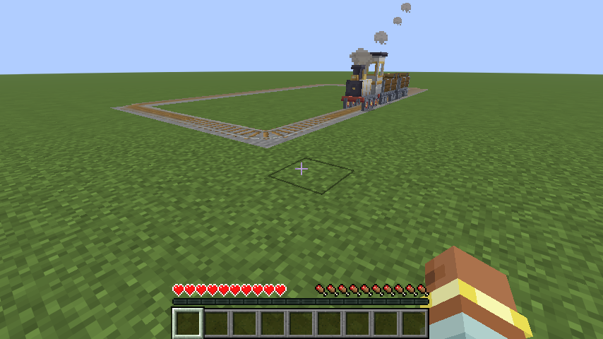

> ⚠️ **Dedicated servers pause when empty.** Set `pause-when-empty-seconds=0` in `server.properties` for 24/7 trains.

## 🖥️ Multiplayer and servers

The server decides everything: positions, seats, couplings and settings, so there's no desync. A full train carries
up to **17 players**. Screens are validated server-side and require you to be within 8 blocks.

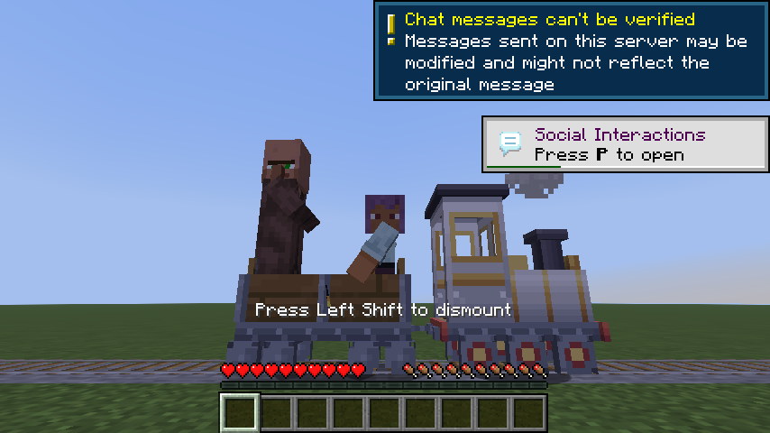

**Operator commands** (permission level 2):

| Command | What it does |
|---|---|
| `/tinytrains list` | Every train in every dimension with position, mode, speed and coaches. **Click to teleport.** |
| `/tinytrains tp <train>` | Teleport to a train, even in unloaded chunks. |
| `/tinytrains stop <train>` | Switch it to Manual and brake to a stop. |
| `/tinytrains stop all` | Stop every train. |

`<train>` is the 8-character id from `list` (Tab-completes) or the train's name in quotes.

**Web maps:** with [squaremap](https://modrinth.com/mod/squaremap) or [Pl3xMap](https://modrinth.com/mod/pl3xmap) on
the server, **Stations** and **Trains** layers appear automatically, with names and speeds on hover. Nothing to set
up, and neither is required.

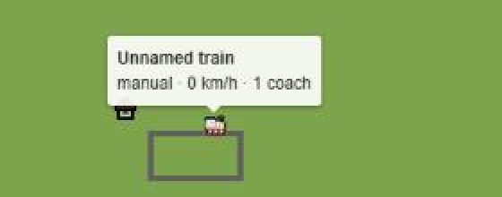 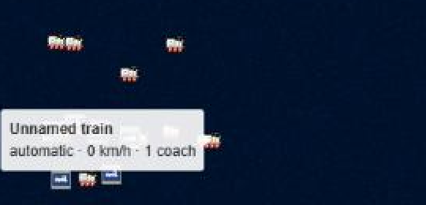

---

<details>
<summary><b>🎨 Resource packs and customisation</b></summary>

There are **no config files**; everything is set per train and per station in game. Everything visual and audible
can be replaced with a resource pack:

| File | What |
|---|---|
| `textures/entity/locomotive.png`, `coach.png` | Model textures (128×128) |
| `textures/entity/locomotive_paint.png` | Paintwork in greys, tinted by the dye |
| `textures/item/locomotive.png`, `locomotive_paint.png`, `coach.png` | Item icons (16×16) |
| `textures/block/station_side.png`, `_top.png`, `_bottom.png` | Station block (16×16) |
| `sounds.json` | Sounds: `train.rolling`, `train.whistle`, `train.hiss`, `train.couple`, `train.switch` |
| `lang/*.json` | All text, tooltips and announcements |

All paths are under `assets/tinytrains/`. Example deeper whistle in `sounds.json`:

```json
{
  "train.whistle": {
    "replace": true,
    "sounds": [{ "name": "note/flute", "pitch": 1.0 }],
    "subtitle": "subtitles.tinytrains.train.whistle"
  }
}
```

</details>

<details>
<summary><b>💡 Optional: glowing locomotives with LambDynamicLights</b></summary>

With [LambDynamicLights](https://modrinth.com/mod/lambdynamiclights), add this to a resource pack at
`assets/tinytrains/dynamiclights/entity/locomotive.json`:

```json
{
  "match": { "type": "tinytrains:locomotive" },
  "luminance": 12
}
```

Not shipped with the mod and not tested together yet.

</details>

## 🧰 Troubleshooting

<details>
<summary><b>My train doesn't move</b></summary>

- **Manual** trains need an open throttle: board and hold <kbd>W</kbd>, or switch to Automatic.
- It may be at a **red signal**, behind **another train or parked coach**, or at the **end of the track**. Check the
  message above your hotbar.
- *"End of the line! Throttle closed."*: the track ends or a junction is set against you.
- Automatic trains wait at stations for the waiting time (up to 120 s).
- *"Waiting for the line ahead to clear"*: another train has booked the track ahead.
- Server with nobody online? It's paused (see Chunk loading).
- Chunk loading off? It waits until a player comes near.
- *"A server operator stopped this train."*: it's now in Manual mode.

</details>

<details>
<summary><b>Two trains are stuck facing each other</b></summary>

They're running opposite ways on single track with no passing loop. Build a loop, switch one train to Manual, drive
it back into the loop, then switch it back to Automatic.

</details>

<details>
<summary><b>My automatic train ignores a station</b></summary>

- The station must be under or right beside the rail the train runs over.
- With a schedule, it only stops at its *current* stop. Check the spelling.
- The station it just left is skipped until the whole train has cleared it.

</details>

<details>
<summary><b>My train goes the wrong way at a junction</b></summary>

- Junctions must be **plain rails**.
- The train needs a **schedule** to choose; otherwise it follows the switch.
- Route search covers 4,096 blocks of **loaded** track; beyond that it heads in the straight-line direction.
- It may be taking the other side of a passing loop to avoid an oncoming train. That's intended.
- Track changes are noticed within 10 seconds.

</details>

<details>
<summary><b>Other problems</b></summary>

- **Can't open the train screen:** sneak + right-click the **locomotive** (not a coach) with an **empty hand**.
- **Ended up on the roof when getting off:** there was no room beside your seat. Leave a block of space at stations.
- **"Every seat is taken."**: 1 seat in the locomotive, 2 per coach. Try another car.
- **Lost a train:** an operator can run `/tinytrains list` and click it.

</details>

## ❓ FAQ

<details>
<summary><b>Does it change vanilla minecarts or rails?</b></summary>

No. Minecarts work exactly as before. Trains only read the rails, and automatic trains flip plain junction rails the
way redstone would.

</details>

<details>
<summary><b>Which rails can trains use?</b></summary>

Any vanilla rail: plain, powered, detector and activator, on flats, slopes and curves.

</details>

<details>
<summary><b>Do trains hurt players or mobs?</b></summary>

No. They pass through players and mobs without pushing, hurting or picking them up.

</details>

<details>
<summary><b>How long can a train be, and how many can I run?</b></summary>

One locomotive and up to 8 coaches (19.75 blocks). Run as many trains as you like; each moving train loads 50 to 75
chunks, so a handful is cheap but hundreds will cost performance.

</details>

<details>
<summary><b>Can trains run backwards or go through portals?</b></summary>

Trains can run coaches-first after reversing, including in automatic mode. They work in any dimension but can't use
portals, so build a separate line per dimension.

</details>

<details>
<summary><b>Will my trains survive a restart?</b></summary>

Yes. Running trains carry on, even with no players nearby. Parked trains stay parked.

</details>

<details>
<summary><b>Is it compatible with other mods?</b></summary>

It uses vanilla rails and standard Fabric APIs and doesn't change vanilla behaviour, so it should get along with most
mods. It hasn't been tested with any particular modpack.

</details>

## ⚠️ Known limitations

- Opposing trains on single track **without passing loops** can't pass each other.
- Only **plain rails** can be junctions. Activator rails do nothing; comparators read 0 from trains.
- Route finding only sees loaded chunks, up to 4,096 rail blocks.
- On curves the coupling link may not line up exactly with the car in front.
- Station countdowns are estimates, corrected every second.
- One kind of locomotive and one kind of coach. Coaches can't be painted, and web map icons don't show paint colours.
- **Not included by design:** freight, item or fluid transport, inventories, logistics.

## 🐛 Reporting bugs

Found a bug or have a question? **[Open an issue on the issue tracker](https://github.com/pvvlvz/TinyTrains-Issue-Tracker/issues)** and include your Minecraft, Fabric Loader, Fabric API and Tiny Trains versions; single player or server and your
other mods; what you did and what happened; a screenshot of your track for routing or station issues; and your
`logs/latest.log` if the game crashed or printed errors.

---

<div align="center">

**Tiny Trains** by **pvvlvz** · Built with [Fabric](https://fabricmc.net/)

All models and textures are original; sounds reuse vanilla sound files.

**All Rights Reserved** © pvvlvz. Do not copy, modify or redistribute without permission.

*Not an official Minecraft product. Not approved by or associated with Mojang or Microsoft.*

</div>
